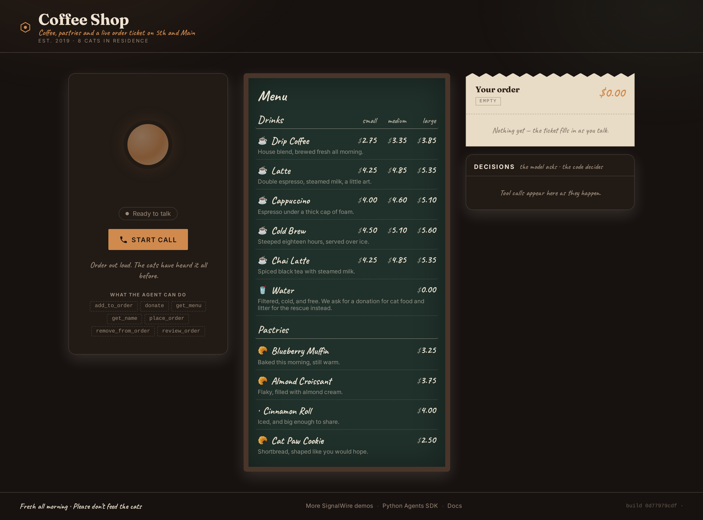

# Coffee Shop

A voice agent that takes a coffee order over the phone or the browser, built on
the [SignalWire Python Agents SDK](https://github.com/signalwire/signalwire-python).
The order ticket on the right of the page updates as you speak, and every tool
call the model makes is printed underneath it.



## What this demo is for

The interesting problem in a voice ordering agent is not transcription — it is
that **a model will happily confirm an order it never recorded**. This demo is
built around that: nothing exists until a tool has run, and the UI shows you
the tool calls so you can see the difference.

Three things here are worth reading the source for:

| Concern | Where | Why |
| --- | --- | --- |
| Off-menu requests | `catalog.py` → `OFF_MENU`, `off_menu()` | Fuzzy string matching answered "water" with "Latte". A written table of the ~30 things a coffee shop actually gets asked for beats string distance. |
| Confidently wrong matches | `catalog.py` → `find_item()` | "pumpkin spice latte" contains "latte", and charging for a plain Latte is worse than asking. A partial match is downgraded to *confirm* when the request carries words the item name does not account for. |
| Fixed-tier payments | `app.py` → `donate()` | The tiers are an `enum` on the parameter *and* validated server-side, so an amount nobody offered cannot reach the order. |

## How it works

```
browser ──WebRTC──┐
                  ├──► SignalWire ──SWML──► /agent          (this app)
phone   ──PSTN────┘                  └────► /agent/swaig/   (tool calls)

/api/state  ◄── browser polls for the live ticket
/api/catalog ◄── menu, rendered client side
/get_token  ◄── mints a scoped guest token for the browser call
```

The agent is one `AgentBase` subclass. `AgentBase.tool` declares each SWAIG
function; the platform calls back into `/agent/swaig/` with a signed token per
function. Order state lives in `state.py`, keyed by call id.

### Tools

| Tool | Purpose |
| --- | --- |
| `get_menu` | Speaks a short menu; puts the full catalog in `global_data`. |
| `add_to_order` | Resolves speech to a catalog item, then adds it. Handles sizes, quantities, off-menu requests and ambiguity. |
| `remove_from_order` | Removes one line. |
| `review_order` | Reads the order back. |
| `donate` | Adds a $10, $20 or $30 donation for cat food and litter. Water is free. |
| `get_name` | Records a first name for the ticket. |
| `place_order` | Closes the order and returns a number. Idempotent. |

## Running it

Requires Python 3.11 and a SignalWire account.

```bash
cp .env.example .env      # fill in SIGNALWIRE_* and set a basic-auth password
pip install -r requirements.txt
python app.py             # serves the agent and the UI on :3000
```

Or with Docker:

```bash
docker build -t coffee-shop .
docker run --rm -p 3000:3000 --env-file .env coffee-shop
```

Then open <http://localhost:3000>. To take a call from the PSTN, the agent needs
a publicly reachable URL — set `SWML_PROXY_URL_BASE` to your tunnel or host and
point a SignalWire phone number at `https://<user>:<pass>@<host>/agent`.

## Configuration

| Variable | Required | Notes |
| --- | --- | --- |
| `SIGNALWIRE_SPACE_NAME` | for calls | Your space, e.g. `example.signalwire.com`. |
| `SIGNALWIRE_PROJECT_ID` | for calls | From the dashboard. |
| `SIGNALWIRE_TOKEN` | for calls | API token. Keep it out of git. |
| `SWML_BASIC_AUTH_USER` | no | Defaults to `signalwire`. |
| `SWML_BASIC_AUTH_PASSWORD` | recommended | If unset, the SDK generates a random one at boot that external callers cannot know — fine locally, useless behind a tunnel. |
| `SWML_PROXY_URL_BASE` | behind a proxy | Public base URL; webhook URLs are built from it. |
| `SIGNALWIRE_SIGNING_KEY` | recommended | Makes the platform sign each webhook and the agent verify it. |
| `PORT` | no | Defaults to 3000. |

## Layout

```
app.py         the agent: prompt, tools, and the web endpoints
catalog.py     the menu, option pricing, and speech-to-item matching
state.py       per-call order state, tool history and anomaly checks
web/           the single-page UI (no build step)
Dockerfile     single worker, deliberately — see below
```

## Notes and limitations

- **Order state is in memory.** `state.py` holds orders in a dict keyed by call
  id, pruned by age. Restarting the process loses in-flight orders, and there
  is no call history after the fact. Fine for a demo; a real shop needs a store.
- **One worker on purpose.** The `Dockerfile` runs a single process because
  order state is in-process. A second worker would serve calls that cannot see
  the order.
- **Set `SIGNALWIRE_SIGNING_KEY` before exposing it.** Without it, anyone who
  finds the endpoint and the basic-auth pair can call the agent's tools
  directly.
- Sizes are priced as **surcharges**, not absolute prices: `OPTIONS["size"]`
  adds `0.00 / 0.60 / 1.10` to an item's base price. Items opt out with
  `"options": []`.

## Links

- [More SignalWire demos](https://github.com/signalwire-demos)
- [SignalWire Python Agents SDK](https://github.com/signalwire/signalwire-python)
- [Agents SDK documentation](https://developer.signalwire.com/sdks/agents-sdk/)

Based on the [cinebot](https://github.com/signalwire-demos/cinebot) demo.
